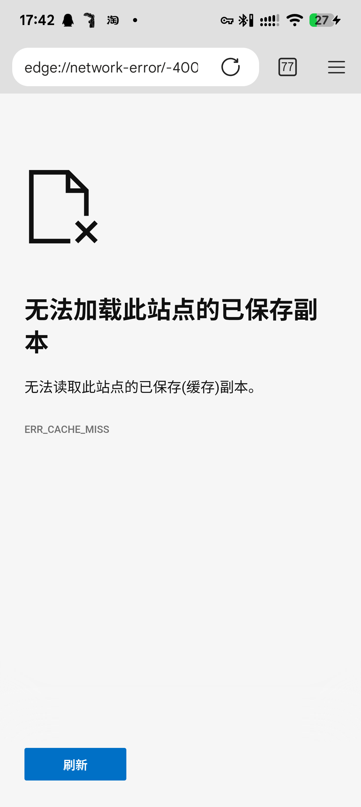
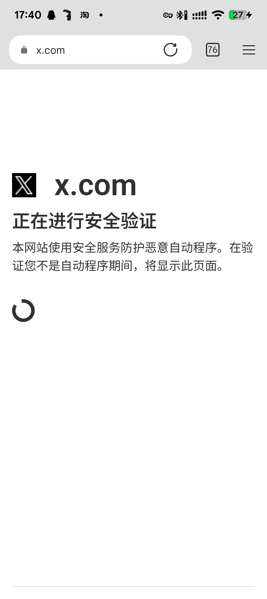

# EdgeBar

将 Microsoft Edge Android 的原生地址栏、标签计数按钮和菜单组合成单行工具栏的 libxposed 模块。

[下载最新 APK](https://github.com/ODtian/EdgeBar/releases/latest) · [版本记录](CHANGELOG.md) · [实现与调用链](docs/architecture.md) · [构建方法](docs/build.md)

## 功能

- 网页采用单行地址栏与工具按钮，输入时使用原生地址输入和建议列表。
- 支持地址左对齐／居中，以及标签、后退、前进、新标签页按钮的排列。
- 支持将新标签页工具按钮放在顶部或中间搜索框旁。
- 沿用原生按钮点击、标签计数、主题和配置变化生命周期。
- 提供 Chrome Web Store、Edge Add-ons 和本地 CRX／ZIP 安装入口，由 Edge 原生扩展流程完成安装。

## 安装

1. 从 [Releases](https://github.com/ODtian/EdgeBar/releases/latest) 下载并安装 APK。
2. 在支持 libxposed API 102 的 LSPosed／Vector 中启用 EdgeBar，作用域选择 `com.microsoft.emmx`。
3. 重启 Edge。
4. 打开“EdgeBar 设置”，调整排列、地址对齐和新标签页按钮位置，点击“保存并在 Edge 应用”。

覆盖安装沿用已保存的模块设置。

## 当前版本

| 项目 | 已验证配置 |
| --- | --- |
| EdgeBar | 0.5.14 |
| Edge | 157.0.4341.42，arm64-v8a |
| 框架接口 | libxposed API 102 |
| 实机 | PJF110，Android 16 |
| 模块最低系统版本 | Android 10 / API 29 |
| 模块包名 | `dev.edgestyle.module` |

0.5.14 修复 InPrivate 起始页的标签计数与菜单按钮消失。页面分流复用 Edge 原生隐私状态，InPrivate 起始页使用顶栏按钮，普通新标签页沿用页面内的按钮位置设置。

## 实机截图

 

## 项目结构

```text
module/                  Android 清单、Java 源码、资源和 Xposed 元数据
tools/build.py           javac → D8 → aapt2 → zipalign → apksigner 构建链
tools/NativeRoleProbe.java  已安装 Edge APK 的原生职责定位探针
third_party/libxposed/   API 102 编译与运行时依赖及许可
docs/                   构建说明、调用链和实机截图
CHANGELOG.md            版本记录
```

开发环境使用 JDK 17、Python 3、Android SDK Platform 36 与 Build Tools 36.0.0。运行 `python tools/build.py --sdk-root <Android-SDK>`，生成 `dist/EdgeBar-v0.5.14.apk`。参数和签名配置见[构建方法](docs/build.md)。

第三方组件的来源和许可见 [THIRD_PARTY_NOTICES.md](THIRD_PARTY_NOTICES.md)。
